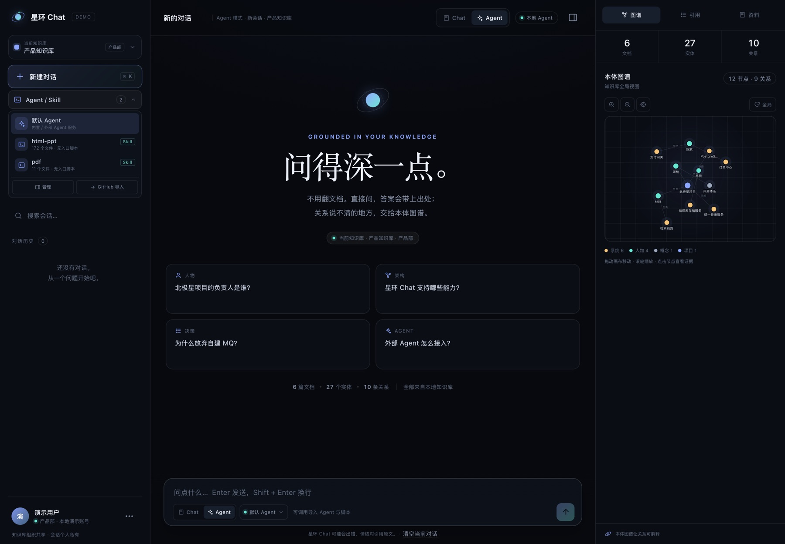

# 星环 Chat

面向团队的多部门 AI 对话工作台：**Chat / Agent 双模式、可导入 Agent Markdown 与参考脚本、RAG + Ontology、会话持久化、多用户与部门知识库隔离**。



## 快速开始

```bash
git clone https://github.com/rexxie0118/xinghuan-chat.git
cd xinghuan-chat

python3 -m venv .venv
.venv/bin/pip install -r requirements.txt

.venv/bin/python -m webchat --host 127.0.0.1 --port 8787
```

打开 <http://127.0.0.1:8787>，演示账号：

| 账号 | 密码 | 部门 |
| --- | --- | --- |
| `demo` | `demo1234` | 产品部 |
| `alice` | `alice1234` | 研发部 |
| `bob` | `bob1234` | 人事部 |

默认 `mock` provider，不需要 API Key，离线可跑通检索、图谱、Agent 脚本执行和引用链路。

## 功能

- 部门知识库切换，会话按「用户 + 知识库」隔离
- 输入框内 `Chat` / `Agent` 模式切换
- 左侧 Agent / Skill 子菜单，维护导入项
- 导入 Agent Markdown + `.py` / `.sh` / `.js` 参考脚本
- 从 GitHub 仓库/目录自动导入 `SKILL.md` / `AGENT.md`
- MCP stdio/HTTP 工具注册表（白名单、超时、调用 API）
- Apple Container 一次性 Agent 执行沙箱
- AgentKernel + 可信 plugin hook / manifest / tool 扩展
- LLM Tool Loop：MCP/plugin tools 自动调用
- Token-aware context budget：历史/证据/工具结果压缩
- 用户级长期记忆：fact / preference / task
- 记忆管理 UI：查看/筛选/添加/删除
- 并发准入：全局/用户 semaphore、队列、429 背压、运行超时
- Postgres / Redis Worker / S3 对象存储适配
- MCP 连接池/分片：round-robin + failover
- 声明式联网连接器：校验/审批/测试后注册 Tool
- Chat 联网开关：按需进入 Tool Loop
- Web Research：search / fetch / source rank / conflict detect
- 统一工具结果：content / structured / sources / url
- 插件权限/信任：trust + allowlist + secrets
- 评测集/失败注入：6 个确定性场景
- 可观测性：request_id / audit_events / metrics
- 内置 RAG/ImportedAgent/MCP 适配插件
- 部门 RBAC：默认 KB + 默认 Agent
- 记忆质量：近重复合并、置信度门槛、整理/预算
- 记忆 scope/provenance：个人/部门/全公司 + 来源
- 共享记忆审批、审计回滚、后台整理任务
- 记忆评测：约束/过期/范围/审批/来源/回滚
- 语义合并：LLM 判定同义记忆
- 团队记忆：成员提交、角色视图、权威性冲突
- 知识库文档管理：上传/删除/重建索引
- Office 解析：PDF/DOCX/PPTX/XLSX/XLS
- Apple Container 预热池：warm/lease/quota
- 页面内 Docs：迭代记录、Todo、历史架构图
- Agent 模式执行脚本，展示 stdout / stderr / exit code / 工具轨迹
- RAG 混合检索 + 本体图谱 + 引用回查
- 多用户、HttpOnly Session、SQLite 持久化
- DeepSeek / ARK / OpenAI 兼容模型可配置
- 执行层抽象为 `SandboxRunner`，后续可替换 Docker / K8s

## 文档

- 应用详细说明：[webchat/README.md](webchat/README.md)
- Agent 执行扩展点：[webchat/docs/architecture.md](webchat/docs/architecture.md)
- 示例 Agent：[webchat/examples/sample_agent/AGENT.md](webchat/examples/sample_agent/AGENT.md)
- 测试：` .venv/bin/python -m unittest webchat.tests.test_api -v`

## 安全边界

当前 Agent 脚本由服务端本地受限子进程执行，**不是强沙箱**。只应导入可信脚本；生产环境请使用 `SandboxRunner` 接入 Docker / Kubernetes / gVisor，并增加 artifact 存储、配额与审计。

## License

未声明 License。使用前请先确认代码来源与授权。
